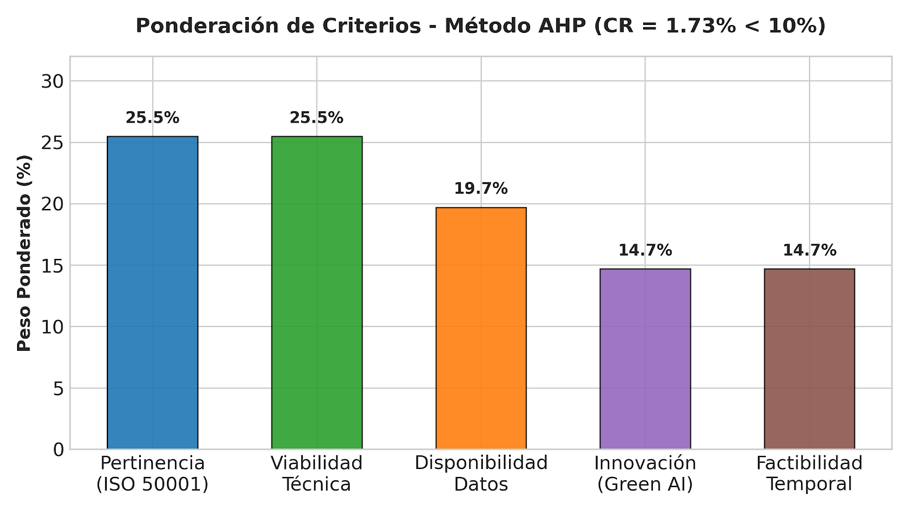
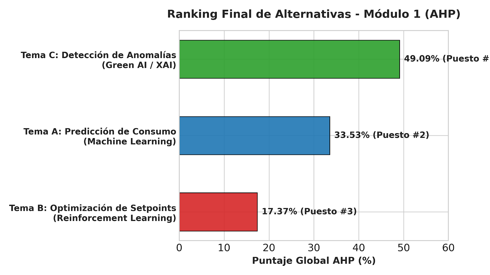
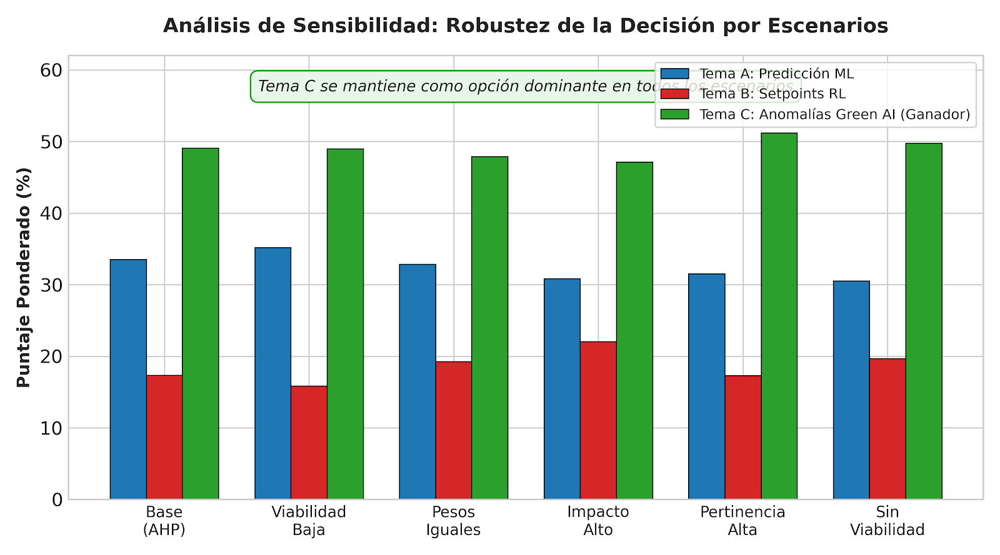
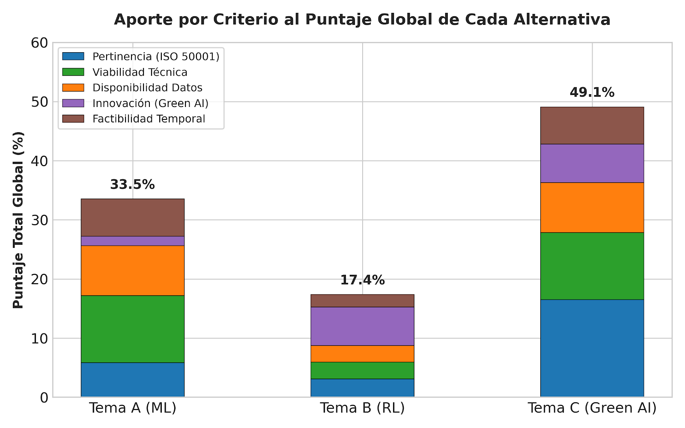

# Módulo 1: Toma de Decisiones Multicriterio (AHP)

## Selección del Tema de Proyecto Final de Carrera
**Carrera:** Ingeniería Industrial  
**Cátedra:** Técnicas y Herramientas Modernas II  
**Eje Temático:** Optimización de Procesos Industriales con Inteligencia Artificial para la Eficiencia Energética (Marco ISO 50001)  
**Integrantes:**
* Pedro Elizalde
* Matteo Pratelesi
* Francisco Allamand
* Francisco Peiro

---

## 1. Definición de Alternativas

Se evaluaron tres propuestas de Trabajo Final de Carrera orientadas a la optimización energética en plantas industriales:

* **Tema A — Predicción de consumo energético industrial con Machine Learning:** Modelado predictivo de demanda mediante SVR, Random Forest y Deep Learning (LSTM) para la etapa de Planificación (PLAN) según ISO 50001.
* **Tema B — Optimización de setpoints de proceso con Reinforcement Learning:** Control operacional autónomo en lazo cerrado para equipos térmicos y motrices (etapa DO), formulado como proceso de decisión de Markov (MDP).
* **Tema C — Detección de anomalías energéticas con IA en procesos industriales (Seleccionado):** Algoritmo semi-supervisado SAnD, reducción de dimensionalidad multivariante, enfoque Green AI de baja huella computacional y explicabilidad causal con SHAP para la etapa de Verificación (CHECK) según ISO 50001.

---

## 2. Ponderación de Criterios

Los criterios fueron ponderados mediante la matriz de juicios de Saaty, obteniendo una Razón de Consistencia **CR = 1.73% (< 10%)**:

| Criterio | Descripción | Peso AHP (%) |
| :--- | :--- | :---: |
| **Pertinencia Industrial** | Alineación con competencias del perfil y ciclo PDCA (ISO 50001) | 25.48% |
| **Viabilidad Técnica** | Factibilidad técnica de algoritmos y ausencia de riesgo operativo físico | 25.48% |
| **Disponibilidad de Datos** | Existencia de series temporales industriales y bases benchmark | 19.69% |
| **Aporte de Innovación** | Incorporación de Green AI, XAI y estado del arte internacional | 14.68% |
| **Factibilidad Temporal** | Capacidad de desarrollo y validación en el plazo de 8 a 10 meses | 14.68% |

  

---

## 3. Matriz de Decisión y Ranking Final

| Alternativa | Pertinencia (25.5%) | Viabilidad (25.5%) | Datos (19.7%) | Innovación (14.7%) | Temporal (14.7%) | Puntaje Global | Posición |
| :--- | :---: | :---: | :---: | :---: | :---: | :---: | :---: |
| **Tema C (Anomalías Green AI)** | **0.6483** | **0.4444** | **0.4286** | **0.4444** | **0.4286** | **49.09%** | **1º** |
| **Tema A (Predicción ML)** | 0.2297 | 0.4444 | 0.4286 | 0.1111 | 0.4286 | 33.53% | 2º |
| **Tema B (Setpoints RL)** | 0.1220 | 0.1111 | 0.1429 | 0.4444 | 0.1429 | 17.37% | 3º |

  

---

## 4. Análisis de Sensibilidad y Contribución

### Análisis de Robustez por Escenarios
Se contrastó el resultado frente a variaciones extremas en los pesos de los criterios:
* **Escenario Viabilidad Baja:** Tema C = 48.99% vs Tema A = 35.19%.
* **Escenario Pesos Iguales (20% c/u):** Tema C = 47.89% vs Tema A = 32.85%.
* **Escenario Innovación Alta:** Tema C = 47.11% vs Tema A = 30.83%.
* **Escenario Sin Viabilidad (0% peso):** Tema C = 49.77% vs Tema A = 30.54%.

En todos los escenarios simulados, **el Tema C se mantiene en el primer puesto**, garantizando que la elección es insensible a perturbaciones en los juicios subjetivos.

  

### Aporte por Criterio al Puntaje Global

  

---

## 5. Archivos del Módulo

* `AHP_Optimizacion_Energia_IA_Modulo_1.xlsx`: Planilla de cálculo con fórmulas interactivas, vector propio (25 iteraciones) y barrido de sensibilidad.
* `Informe_Modulo_1_Toma_de_Decisiones.pdf`: Informe académico completo redactado en LaTeX (Springer LNCS).
* `ANTS2024samplepaper.tex`: Código fuente editable del informe.
* `mybibliography.bib`: Base de referencias en formato BibTeX.
